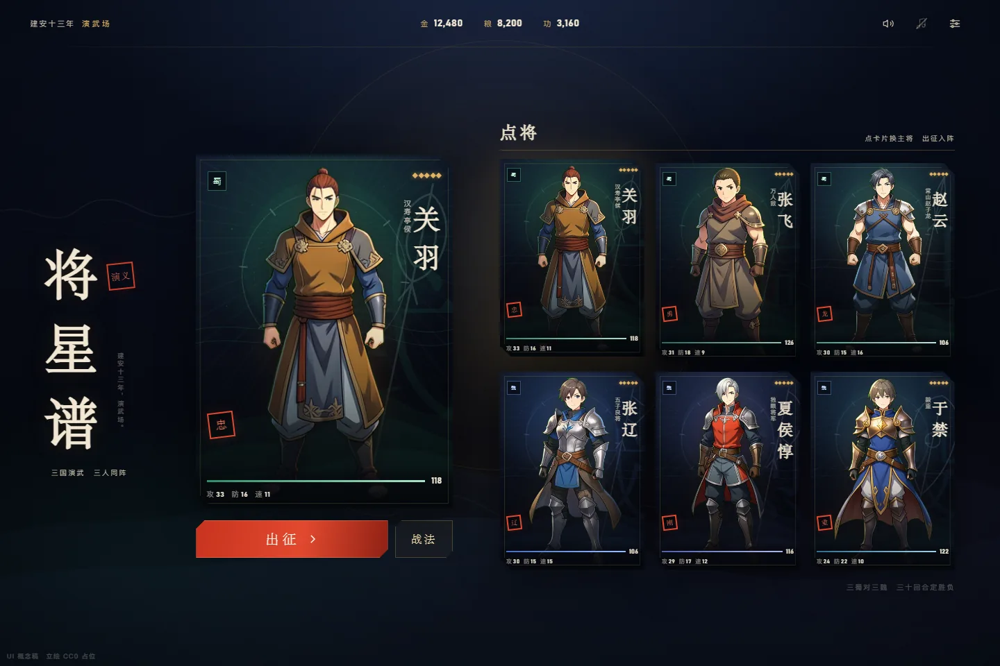
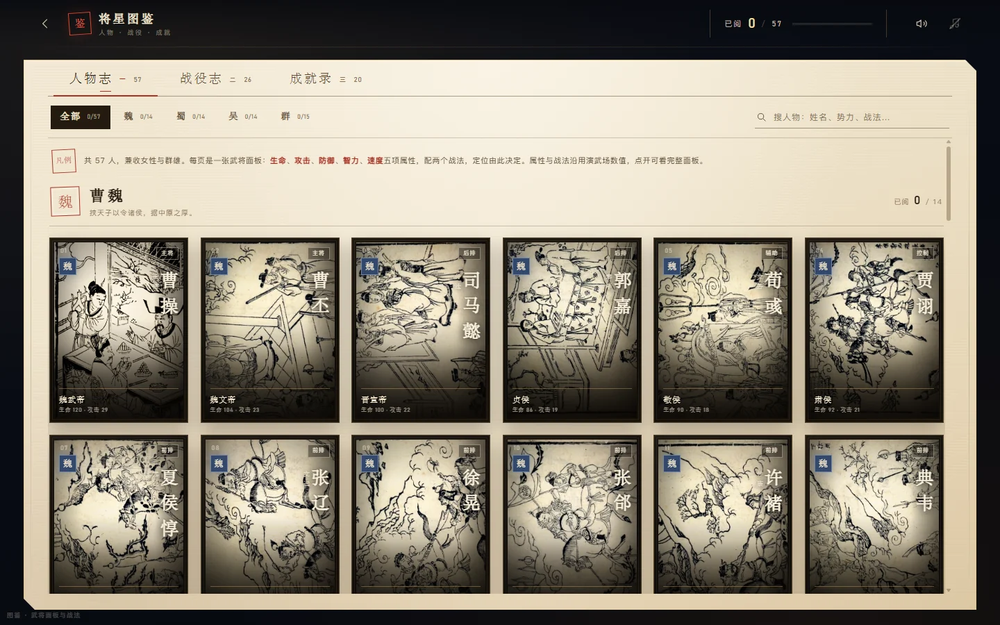
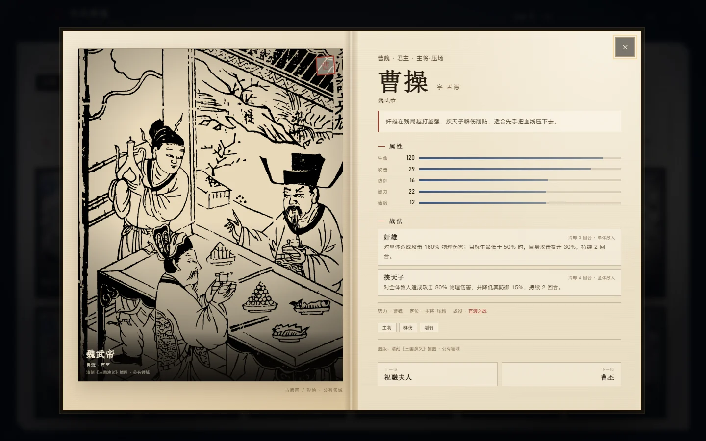

# 将星谱 · 三国卡牌演武

一套可以直接打开、直接点的 **3v3 卡牌战斗 UI 概念稿**。没有框架、没有构建步骤，HTML / CSS / 原生 JS 就是全部界面代码；另有一册可翻阅的「将星图鉴」。

方向是 **国风赛璐璐**：日式赛璐璐上色的人像，加上中国甲胄、水墨山形、金线、朱印与竖排人名。卡牌不是战斗界面的装饰，而是界面本体——点将、选目标、出招、看战报、结算，都在卡上发生。



## 运行

直接双击 `index.html` 即可，`file://` 下可用。也可以起一个静态服务：

```bash
cd anqi/ui-demo
python -m http.server 5173
# http://localhost:5173/
```

## 可以点什么

### 点将台

- 点右侧任一武将卡，左侧海报与「出征」主将随之切换。
- 点左侧大海报或「战法」，打开武将详报：立绘、称号、生命 / 攻 / 防 / 速、两个战法与冷却。
- 「出征」进入 3v3 战场。

### 卡牌战场

- **点敌将卡改目标**，红色角标与「目标」标签会移动。
- 底部军令：普攻、两个战法、防御、详报。
- 战法有冷却；冷却中按钮变暗并显示剩余回合。
- 护盾、吸血、条件增伤都会结算；护盾会以「盾 N」小标签出现在卡面。
- 点我方卡打开详报；点已倒下的卡也可以看详报。
- 「战报」抽屉按时间倒序列出每一次伤害、治疗与技能。
- 「结算」随时打开当前战局预览；战斗自然结束时会自动弹出大捷 / 败北。

### 结算

- 「再战」重置战局；「返回点将」回到首页。
- 评价按存活人数给 S / A / B；失败为 C。

### 将星图鉴

- 首页「将星图鉴」进入；也可直接打开 `#codex`、`#codex/battles`、`#codex/achievements`。
- 收录 **57 位人物**（魏 14 / 蜀 14 / 吴 14 / 群 15）、**26 场战役**、**20 项成就**。
- 人物按势力分组；可按势力筛选，按姓名、字、称号、定位、标签或战法搜索。
- 点人物卡打开册页详情：右页是**游戏面板**——势力、定位、生命 / 攻击 / 防御 / 智力 / 速度五项属性，以及两个战法（冷却与作用目标）；左页仍是图版。详情内可用左右方向键翻页，`Esc` 关闭。
- 面板数据分两层：图鉴收录的 17 名演武场武将（关羽、张飞、赵云、马超、黄忠、魏延、张辽、徐晃、曹仁、夏侯惇、张郃、周瑜、陆逊、吕蒙、甘宁、太史慈、姜维）直接取自 `data/generals.json` 与 `data/skills.json`，数值未改；其余 40 人按同一数值区间与战法格式补齐，写在 `codex-roster.js`。
- 人物图仍是公有领域古版画 / 绣像 / 彩绘（尚未替换为定制立绘）：主体为清大魁堂刊《三国演义》回目插图（`WDL11391`），另有清刻、颐和园长廊彩绘、吴友如《古今百美图》与歌川国芳浮世绘；逐文件来源见 `assets/codex/SOURCE.md`。
- 已阅人物、已读战役、成就进度与战斗记录写入 `localStorage`（键名 `jiangxing.codex.v1`）。完成一场战斗会回写胜场、评价以及完胜 / 速战条件。





### 键盘

- `Tab` 在卡牌与按钮间移动，`Enter` / `Space` 触发卡牌。
- 详报、战报、结算内焦点被约束；`Esc` 关闭当前浮层。
- 开启系统「减少动态效果」后，动画与回合等待都会缩短。

## 动态与声音

- **环境**：云层缓慢漂移、金色余烬上浮、舞台光呼吸。
- **卡面**：大海报周期扫光，选中卡保留箔纹；换将时海报轻换入场。
- **战场**：出手前冲，金线从施法者划向目标，命中出现冲击环与火星；倒下时卡面短暂过曝再灰化；轮到己方时中轴扫光、行动卡金环。
- **结算**：战报海报入场，朱印外扩一圈，背后放射纹缓慢旋转。
- **声音**：全部用 Web Audio 实时合成，没有音频文件。音效覆盖换将、详报、选目标、普攻、战法、命中、护盾、治疗、倒下与胜负；环境音乐是低音持续音加稀疏五声音阶拨弦，音量很低。
- 首页顶部右侧两个按钮分别控制音效与环境音乐；音效默认开启，环境音乐默认关闭。浏览器要求先有一次点击或按键才能出声，开关状态会记在 `localStorage`。
- 「减少动态效果」会停掉光束、火花、扫光等位移动效，但不会关闭声音。

## 卡面结构

每张卡由这些层组成：

1. 势力渐变底 + 水墨山形 + 缓慢旋转的圆环；
2. 武器剪影（青龙偃月、蛇矛、长枪、戟、刀、盾）；
3. 武将立绘、底部暗角、扫光与斜向箔纹；
4. 切角金线框；
5. 势力徽记、五星、竖排名与称号、朱印；
6. 生命条、生命数字、攻 / 防 / 速；
7. 战斗中的「行动」「目标」「盾 N」「败」状态。

全部卡框、纹样、图标、山形与武器都是手写 CSS / SVG，没有使用商业三国游戏的界面素材。

## 角色与数值

首发六人，三蜀对三魏：

| 蜀 | 魏 |
| --- | --- |
| 关羽 · 汉寿亭侯 | 张辽 · 五子良将 |
| 张飞 · 万人敌 | 夏侯惇 · 独眼将军 |
| 赵云 · 常山赵子龙 | 于禁 · 毅重 |

基础生命 / 攻击 / 防御 / 速度取自项目 `data/generals.json` 的六名武将。演示只保留能形成完整对局的技能效果：

- 单体 / 群体伤害；
- 目标残血、自身残血、速度更快、独苗时的条件倍率；
- 吸血、护盾；
- 冷却与按速度的出手顺序；
- 简单的敌方自动出招。

**没有实现**：眩晕、嘲讽、沉默、缴械、反击、易伤、属性增减、后援换将、30 回合上限、确定性随机种子。演示里的伤害与敌方选择使用 `Math.random()`，只用于让 UI 动起来，不代表正式战斗引擎。正式规则以项目根目录 README 为准。

## 立绘与图版许可

**战斗立绘**：六张来自 **Free Game Sprites · Anime Portraits**，**CC0 1.0 Universal**，可商用、可修改、可再分发。它们是西幻动漫风的**占位素材**，不是三国原画，也不完全贴合人物（例如关羽没有长髯与青龙偃月刀）。正式发布前应替换为项目定制立绘。

- 来源与逐文件对应：[`assets/cards/SOURCE.md`](assets/cards/SOURCE.md)
- 资源页：<https://freegamesprites.com/en/packs/anime-portraits>
- 许可：<https://creativecommons.org/publicdomain/zero/1.0/>

**图鉴海报**：57 张全部取自公有领域历史图像。主体为清大魁堂刊《三国演义》回目插图（`WDL11391`），另有少量清刻插图、颐和园长廊彩绘照片、吴友如《古今百美图》与歌川国芳浮世绘；逐文件来源、回目、裁切说明见 [`assets/codex/SOURCE.md`](assets/codex/SOURCE.md)。

- 底本：<https://commons.wikimedia.org/wiki/File:Romance_of_the_Three_Kingdoms_in_Illustrations_WDL11391.pdf>
- 数字馆藏：World Digital Library / Library of Congress，公有领域。

## 目录

```text
ui-demo/
  index.html          页面结构、SVG 图标 / 卡面场景 / 武器剪影
  style.css           设计令牌、卡牌、点将台、战场、浮层、响应式
  app.js              六名武将数据、卡面渲染、战斗流程、焦点管理
  codex.css           图鉴册页、海报卡、筛选、成就、详情与响应式
  codex.js            57 位人物 / 26 场战役 / 20 项成就、渲染、进度、路由
  codex-roster.js     57 人的属性、称号、定位与战法（17 人取自 data/，40 人补齐）
  codex-art.js        战役示意图与人物剪影的 SVG 生成器
  assets/cards/       六张 CC0 立绘 + SOURCE.md
  assets/codex/       图鉴海报（WebP，公有领域版画为主）+ SOURCE.md
  _shots/             桌面 / 手机截图（WebP）与图版处理脚本
```

音效与环境音乐不占资源文件，全部由 `app.js` 的 Web Audio 代码实时合成。

## 适配

- 桌面：1440 / 1024 三栏点将台与横向卡阵。
- 窄屏：首页改为纵向海报 + 横向滑动将卡；战场保留三对三卡阵，军令栏变为五列。
- 手机首页顶部保留音效与环境音乐开关（隐藏设置占位），音量图标仍保持 44px 触控区域。
- 触屏不启用倾斜；鼠标设备才有卡面跟随指针的 3D 倾斜与扫光。
- 图鉴桌面为六列海报墙，1280 / 1080 / 900 / 760 / 420 逐级降到五 / 四 / 三 / 二列；详情册页在窄屏改为单页竖排。
- 焦点环、`aria-live` 战报、`role="progressbar"` 生命条与成就进度、对话框焦点陷阱、`aria-pressed` 音频开关、`prefers-reduced-motion` 均已接入。
- 图鉴详情支持 `Esc` 关闭、左右方向键翻页、关闭后焦点回到原卡片；筛选与搜索状态通过 `aria-live` 播报。

## 已知取舍

- 立绘是占位，且六张原画的色温不完全统一；卡框、势力色与暗角负责把它们收成一套。
- 战斗是 UI 演示，不是正式引擎；数值、AI 与状态效果都做了裁剪。
- 音效与环境音乐是浏览器实时合成的概念音，不是录制素材；没有音量滑杆，也没有多轨 BGM。浏览器要求首次交互后才允许播放。
- 没有联网与后端；声音开关与图鉴进度存在浏览器 `localStorage`，换浏览器或清缓存会丢失。
- 图鉴的 57 张海报全部来自公有领域历史图像，刻工、纸色、尺寸与清晰度不齐：刘表绣像原图仅 359×479，祝融夫人为浮世绘（彩色、风格与清刻线描不同），黄月英的图版画的是孔明造木牛流马、她本人不在画中。已尽量统一色调与纸感，逐条注明来源；立绘替换工作另行安排。
- 图鉴里只有 17 人的面板来自 `data/`；其余 40 人按同一数值区间补齐，是图鉴演示数据，加入正式演武场前需要复核平衡。
- 手机端详报内容较长时需要纵向滚动；关闭按钮固定右上角。

## 许可

- 界面代码沿用项目根目录的 MIT License。
- 立绘为 CC0，详见 `assets/cards/SOURCE.md`。
- 设计方法参考了本地安装的 `frontend-design`（Apache-2.0）与 `web-design-engineer`（MIT）规则；未复制或运行其代码。
